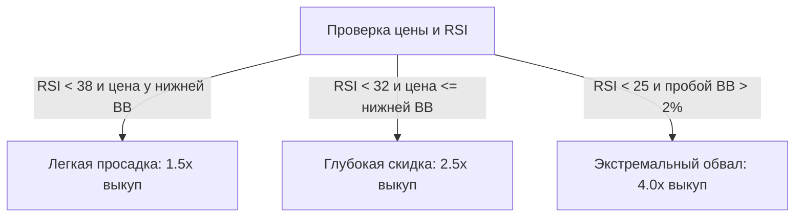

# 🐷💰 Bybit Smart Piggybank: Autonomous AI-Driven Portfolio Accumulator

<div align="center">

[](https://www.python.org/)
[](https://opensource.org/licenses/MIT)
[](https://www.bybit.com)
[](https://modelcontextprotocol.io)
[](https://fastapi.tiangolo.com)
[](https://tailwindcss.com/)

**Умный автономный накопительный движок для формирования классического крипто-портфеля (BTC, ETH, SOL) на Bybit с алгоритмическим выкупом просадок, фиксацией прибыли в резерв, риск-менеджментом, Web-дашбордом и поддержкой AI-оператора через MCP.**

[Возможности](#-ключевые-возможности) • [Архитектура](#-архитектура-движка) • [Стратегия](#-тройная-логика-накопления) • [Установка](#-быстрый-старт) • [AI-Оператор (MCP)](#-ai-оператор--mcp-протокол) • [Дашборд](#-веб-дашборд)

</div>

---

## ⚡ О проекте

Обычные DCA-боты слепо покупают активы по таймеру, покупая как на дне, так и на самых пиках перед затяжными падениями. 
**Bybit Smart Piggybank** спроектирован по принципам профессиональных торговых систем (вдохновлен архитектурой `bybit-ws`), но адаптирован под **безопасное спотовое накопление капитала (Spot, без риска ликвидаций)**:

* 📉 **Покупает больше, когда рынок на дне (Smart Dip-Buying):** динамический мультипликатор объема ордера до **4.0x** по полосам Боллинджера и перепроданности RSI.
* 📈 **Фиксирует сверхприбыль на пампах (Profit Harvester):** сбрасывает 15–20% позиции обратно в USDT-резерв на сильном перегреве (RSI > 75 + верхний Боллинджер), пополняя пул ликвидности под будущие скидки.
* 🛡️ **Защищает от "падающих ножей":** встроенный **Circuit Breaker** замораживает закупки при аномальных обвалах рынка.
* 🧠 **Готов к управлению ИИ (AI-Native):** встроенный сервер протокола **MCP (Model Context Protocol)** позволяет вашим любимым LLM (Claude, Cursor, Antigravity) выступать оператором фонда.

---

## 🌟 Ключевые возможности

| Функция | Описание |
| :--- | :--- |
| **Режим симуляции (Dry-Run)** | Работает на реальных тикерах Bybit со стартовым виртуальным балансом `$1,000 USDT`. Безопасная калибровка без реальных денег. |
| **Классическая корзина** | Сбалансированный портфель: **BTC (45%)**, **ETH (35%)**, **SOL (20%)** с резервом в **USDT**. |
| **Умный Stop-Crash (Circuit Breaker)** | Мониторинг просадки BTC. При 24ч падении > 10% покупки замораживаются для предотвращения ловли ножей. |
| **Cost-Basis Бухгалтерия** | Точный учет средневзвешенной цены входа для каждого актива в локальной базе SQLite. |
| **Дневной лимит трат** | Жесткий потолок на расходование USDT в течение 24 часов (по умолчанию $150). |
| **Telegram-алерты** | Мгновенные уведомления о сделках, фиксациях профита и состоянии рынка с красивым форматированием. |
| **Cyberpunk Web-Дашборд** | Быстрый интерфейс на FastAPI + Tailwind CSS: живые метрики, PnL, радар индикаторов и ручные кнопки. |

---

## 🏗 Архитектура движка

Движок функционирует в неблокирующем асинхронном цикле (`asyncio`), разделяя задачи по частоте вычислений:

```
┌───────────────── FAST TICK LOOP (каждые 60 сек) ─────────────────┐
│ • Сбор тикеров и свечей Bybit v5 (1h timeframe)                  │
│ • Расчет полос Боллинджера (20, 2.0) и RSI (14)                   │
│ • Проверка Circuit Breaker (крах BTC за 24ч)                     │
│ • Profit Harvester: проверка условий фиксации пампа в USDT       │
├──────────────────────────────────────────────────────────────────┤
│ HEAVY ANALYSIS LOOP (каждые ~5 минут)                            │
│ • Оценка Smart Dip-Buying для каждого актива                     │
│ • Применение динамических мультипликаторов (1.5x / 2.5x / 4.0x)  │
│ • Проверка суточного лимита и пола резерва                       │
│ • Исполнение ордеров выкупа просадки + Telegram алерт            │
├──────────────────────────────────────────────────────────────────┤
│ SCHEDULED ROUTINE (раз в 24 часа)                                │
│ • Плановый базовый DCA-выкуп                                     │
│ • Синхронизация балансов и пересчет средних цен                  │
└──────────────────────────────────────────────────────────────────┘
```

---

## 🎯 Тройная логика накопления

### 1. Регулярный DCA (Scheduled DCA)
Раз в сутки бот совершает базовые покупки активов согласно целевым долям (например, BTC $15, ETH $10, SOL $5), обеспечивая монотонный приток позиций.

### 2. Умный выкуп просадок (Smart Dip-Buying)
Когда на рынке происходит коррекция, система рассчитывает положение цены относительно полос Боллинджера и индекс RSI:



### 3. Сбор урожая (Profit Harvester & Rebalance)
Большинство людей не фиксируют прибыль вовремя. Piggybank защищает накопленное:
* **Условие:** Актив вырос более чем на **+12%** от средней цены покупки, пробил верхнюю полосу Боллинджера, а RSI перевалил за **75.0** (эйфория).
* **Действие:** Продает **15–20%** от накопленного объема актива, переводит прибыль в USDT и пополняет резервный фонд для выкупа следующей неизбежной просадки.

---

## 🚀 Быстрый старт

### 1. Клонирование и установка зависимостей
```bash
git clone https://github.com/markankamaransheogarat-sys/bybit-smart-piggybank.git
cd bybit-smart-piggybank
pip install -r requirements.txt
```

### 2. Конфигурация окружения
Скопируйте пример файла конфигурации:
```bash
cp .env.example .env
```
Заполните `.env`:
```ini
# Bybit API Keys (Оставьте пустыми для безопасного режима симуляции!)
BYBIT_API_KEY=your_key_here
BYBIT_API_SECRET=your_secret_here
BYBIT_TESTNET=false

# Telegram алерты (по желанию)
TELEGRAM_BOT_TOKEN=your_bot_token
TELEGRAM_CHAT_ID=your_chat_id

# Dashboard & Server
DASHBOARD_HOST=127.0.0.1
DASHBOARD_PORT=8080
```

> **Важно:** В файле `config/config.yaml` по умолчанию включен флаг `dry_run: true`. Вы можете тестировать алгоритм на живых ценах Bybit без риска для реального депозита!

### 3. Запуск
```bash
python main.py
```
После запуска откройте в браузере: **`http://127.0.0.1:8080`**.

---

## 🤖 AI-Оператор & MCP Протокол

В систему встроен сервер **Model Context Protocol (MCP)**, позволяющий подключать современные ИИ-модели (Cursor, Claude Desktop, Antigravity) в качестве живых управляющих портфелем:

### Доступные MCP-инструменты:
1. `get_piggybank_status`: Возвращает актуальный состав портфеля, PnL по каждой монете, остаток резерва USDT и суточные лимиты.
2. `get_market_analysis`: Возвращает текущие показания полос Боллинджера, RSI и статус просадок/пампов.
3. `ai_operator_execute_buy`: Позволяет ИИ по вашей команде или собственному анализу совершить внеплановый выкуп с фиксацией аргументации.
4. `ai_operator_harvest_profit`: Позволяет ИИ зафиксировать процент от позиции в стейблкоины.

---

## 📊 Веб-Дашборд

Дашборд доступен на порту `8080` и обновляется в реальном времени каждые 5 секунд:
* **Сводка портфеля:** общий эквивалент в USD, баланс USDT, суточные расходы.
* **Таблица активов:** количество, текущая цена Bybit, средневзвешенная точка входа, плавающий PnL и кнопки быстрого DCA / фиксации.
* **Радар рынка:** наглядное отображение RSI и границ Боллинджера.
* **Лента ордеров:** подробный журнал со стратегиями и деталями входа.

---

## 🔒 Безопасность и дисклеймер

* Проект предназначен для спотового накопления. Спот не несет риска ликвидации, однако криптовалютный рынок высокорискован.
* Не передавайте ваши API-ключи третьим лицам. Создавайте на Bybit ключи с ограничением по IP и доступом **только к Spot Trading** (без права на вывод средств!).
* Автор не несет ответственности за возможные финансовые потери. Протестируйте стратегию в режиме `dry_run: true` перед запуском с реальными средствами.

---

<div align="center">
  <b>Built with ❤️ for disciplined crypto accumulation</b>
</div>
