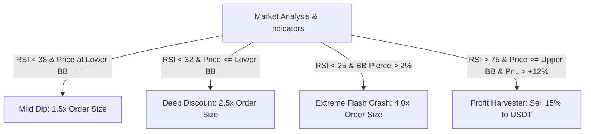

# 🐷💰 Bybit Smart Piggybank: Autonomous AI-Driven Portfolio Accumulator

<div align="center">

[](https://www.python.org/)
[](https://opensource.org/licenses/MIT)
[](https://www.bybit.com)
[](https://modelcontextprotocol.io)
[](https://fastapi.tiangolo.com)
[](https://tailwindcss.com/)

**An autonomous, algorithmic portfolio accumulation engine for building a classical crypto basket (BTC, ETH, SOL) on Bybit Spot. Features dynamic dip-buying, profit harvesting back into reserve, automated risk management, real-time Web Dashboard, and native AI operator support via MCP.**

[English](#-english-version) • [Русская версия](#-русская-версия)

</div>

---

# 🇬🇧 English Version

## ⚡ Overview

Conventional DCA bots blindly purchase assets on rigid schedules, frequently buying local tops immediately before catastrophic market downtrends. 
**Bybit Smart Piggybank** takes inspiration from high-grade quantitative trading architectures (inspired by `bybit-ws`) but adapts them specifically for **safe, non-liquidatable Spot portfolio accumulation**:

* 📉 **Aggressive Dip-Buying (Smart Dip Engine):** Scales position sizes up to **4.0x** when price kisses or pierces Lower Bollinger Bands paired with RSI oversold extremes.
* 📈 **Profit Harvester & Rebalancer:** Automatically trims 15–20% of accumulated positions during extreme euphoric pumps (RSI > 75 + Upper Bollinger Band breakout) into liquid USDT, replenishing dry powder for the next inevitable discount.
* 🛡️ **Anti-Falling Knife Defense (Circuit Breaker):** Dynamically halts all purchase activities when macro assets (e.g. BTC) crash > 10% in 24 hours.
* 🧠 **AI-Native & Operator-Ready (MCP):** Embedded **Model Context Protocol (MCP)** server allows modern LLM agents (Claude, Cursor, Antigravity) to inspect, monitor, and direct portfolio actions directly via chat.

---

## 🌟 Key Capabilities

| Feature | Description |
| :--- | :--- |
| **Simulation Mode (Dry-Run)** | Runs against live Bybit order books and real-time candles with a virtual `$1,000 USDT` bankroll. Completely risk-free testing. |
| **Classical Basket** | Balanced baseline allocation: **BTC (45%)**, **ETH (35%)**, **SOL (20%)** with **USDT** liquid reserve. |
| **Circuit Breaker** | Real-time market crash sentinel. Freezes buying upon flash crashes to prevent catching falling knives. |
| **Cost-Basis Accounting** | Tracks weighted average acquisition price per asset in local SQLite database. |
| **Daily Spend Ceiling** | Hard configurable cap on total USDT deployed within any rolling 24-hour window (default: $150). |
| **Telegram Notifications** | Beautiful, instant alerts on orders, profit-taking harvests, and market status. |
| **Cyberpunk Web Dashboard** | Fast UI built on FastAPI + Tailwind CSS: live metrics, PnL per coin, indicator radar, and manual action buttons. |

---

## 🏗 Engine Architecture

The engine runs a non-blocking asynchronous event loop (`asyncio`) partitioned into 3 distinct operational cadences:

```
┌───────────────── FAST TICK LOOP (every 60s) ──────────────────────┐
│ • Ingest live Bybit v5 Spot candles & order books (1h timeframe) │
│ • Compute Bollinger Bands (20, 2.0) & RSI (14)                   │
│ • Evaluate Circuit Breaker status (BTC 24h delta)                │
│ • Profit Harvester: verify overbought & take-profit criteria     │
├──────────────────────────────────────────────────────────────────┤
│ HEAVY ANALYSIS LOOP (every ~5 minutes)                           │
│ • Evaluate Smart Dip-Buying triggers for each asset              │
│ • Apply dynamic multipliers (1.5x / 2.5x / 4.0x)                 │
│ • Validate daily spend ceiling & reserve floor rules             │
│ • Dispatch market buy orders + push Telegram notification        │
├──────────────────────────────────────────────────────────────────┤
│ SCHEDULED ROUTINE (every 24 hours)                               │
│ • Base scheduled DCA accumulation pass                           │
│ • Synchronize balances & recalculate average cost basis          │
└──────────────────────────────────────────────────────────────────┘
```

---

## 🎯 Triple Accumulation Logic



---

## 🚀 Quick Start

### 1. Clone & Install
```bash
git clone https://github.com/markankamaransheogarat-sys/bybit-smart-piggybank.git
cd bybit-smart-piggybank
pip install -r requirements.txt
```

### 2. Configuration
Copy the environment template:
```bash
cp .env.example .env
```
Populate `.env` (leave API keys blank for Simulation/Dry-Run):
```ini
BYBIT_API_KEY=your_key_here
BYBIT_API_SECRET=your_secret_here
BYBIT_TESTNET=false

TELEGRAM_BOT_TOKEN=your_bot_token
TELEGRAM_CHAT_ID=your_chat_id

DASHBOARD_HOST=127.0.0.1
DASHBOARD_PORT=8080
```

> **Note:** By default, `config/config.yaml` has `dry_run: true`. You can run and test everything against real Bybit market prices safely without real capital!

### 3. Launch
```bash
python main.py
```
Open **`http://127.0.0.1:8080`** in your browser to view the live dashboard!

---

## 🤖 AI Operator & MCP Protocol

An embedded **Model Context Protocol (MCP)** server allows external LLMs to act as fund operators:

* `get_piggybank_status`: Returns balances, PnL per asset, reserve USDT, and daily spend limits.
* `get_market_analysis`: Returns current Bollinger Bands, RSI, and dip/harvest metrics.
* `ai_operator_execute_buy`: Empowers the AI to execute discretionary buys with structured reasoning.
* `ai_operator_harvest_profit`: Allows the AI to harvest percentage of holdings into USDT.

---

<br>

# 🇷🇺 Русская версия

## ⚡ О проекте

Обычные DCA-боты слепо покупают активы по таймеру, покупая как на дне, так и на самых пиках перед затяжными падениями. 
**Bybit Smart Piggybank** спроектирован по принципам профессиональных торговых систем (вдохновлен архитектурой `bybit-ws`), но адаптирован под **безопасное спотовое накопление капитала (Spot, без риска ликвидаций)**:

* 📉 **Покупает больше, когда рынок на дне (Smart Dip-Buying):** динамический мультипликатор объема ордера до **4.0x** по полосам Боллинджера и перепроданности RSI.
* 📈 **Фиксирует сверхприбыль на пампах (Profit Harvester):** сбрасывает 15–20% позиции обратно в USDT-резерв на сильном перегреве (RSI > 75 + верхний Боллинджер), пополняя пул ликвидности под будущие скидки.
* 🛡️ **Защищает от "падающих ножей":** встроенный **Circuit Breaker** замораживает закупки при аномальных обвалах рынка.
* 🧠 **Готов к управлению ИИ (AI-Native):** встроенный сервер протокола **MCP (Model Context Protocol)** позволяет вашим любимым LLM (Claude, Cursor, Antigravity) выступать оператором фонда.

---

## 🌟 Ключевые возможности

| Функция | Описание |
| :--- | :--- |
| **Режим симуляции (Dry-Run)** | Работает на реальных тикерах Bybit со стартовым виртуальным балансом `$1,000 USDT`. Безопасная калибровка без реальных денег. |
| **Классическая корзина** | Сбалансированный портфель: **BTC (45%)**, **ETH (35%)**, **SOL (20%)** с резервом в **USDT**. |
| **Умный Stop-Crash (Circuit Breaker)** | Мониторинг просадки BTC. При 24ч падении > 10% покупки замораживаются для предотвращения ловли ножей. |
| **Cost-Basis Бухгалтерия** | Точный учет средневзвешенной цены входа для каждого актива в локальной базе SQLite. |
| **Дневной лимит трат** | Жесткий потолок на расходование USDT в течение 24 часов (по умолчанию $150). |
| **Telegram-алерты** | Мгновенные уведомления о сделках, фиксациях профита и состоянии рынка с красивым форматированием. |
| **Cyberpunk Web-Дашборд** | Быстрый интерфейс на FastAPI + Tailwind CSS: живые метрики, PnL, радар индикаторов и ручные кнопки. |

---

## 🎯 Тройная логика накопления

1. **Регулярный DCA (Scheduled DCA):** базовый периодический выкуп по расписанию (раз в сутки).
2. **Умный выкуп просадок (Smart Dip-Buying):** при касании/пробое нижней полосы Боллинджера и падении RSI (<38) активируется динамический множитель (1.5x, 2.5x или до 4x на экстремальных скидках).
3. **Сбор урожая (Profit Harvester & Rebalance):** при перегреве рынка (выход за верхнюю полосу Боллинджера + RSI > 75 и профит от +12%) продает 15–20% от объема позиции в стейблкоины для пополнения пула ликвидности.

---

## 🚀 Быстрый запуск

```bash
git clone https://github.com/markankamaransheogarat-sys/bybit-smart-piggybank.git
cd bybit-smart-piggybank
pip install -r requirements.txt
cp .env.example .env
python main.py
```
Веб-дашборд откроется по адресу: **`http://127.0.0.1:8080`**.

---

## 👥 Author

* **Creator & Architect:** [@markankamaransheogarat-sys](https://github.com/markankamaransheogarat-sys) (markankamaran) — Systems & Quant Architecture.

Pull requests, discussions, and feature proposals are warmly welcome! Feel free to open an issue or PR.

---

## 🔒 Дисклеймер / Disclaimer

This software is for educational and portfolio management purposes. Crypto spot trading involves market risks. Always test thoroughly in simulation mode (`dry_run: true`) before deploying real assets.

---

<div align="center">
  <b>Built with ❤️ for disciplined crypto accumulation</b>
</div>
